# NexaSecure Solutions

API REST desenvolvida em PHP e MySQL para gerenciamento de serviços de cibersegurança.

## Sobre o projeto

A NexaSecure Solutions é um projeto acadêmico que tem como objetivo organizar e gerenciar informações relacionadas à segurança da informação, permitindo o controle de clientes, ativos e ordens de serviço.

## Funcionalidades

- Cadastro, consulta, atualização e exclusão de clientes.
- Cadastro, consulta, atualização e exclusão de ativos.
- Cadastro, consulta, atualização e exclusão de ordens de serviço.
- Integração com banco de dados MySQL.
- Comunicação por meio de requisições HTTP e respostas JSON.

## Tecnologias utilizadas

- PHP
- MySQL
- PDO
- Visual Studio Code
- Postman
- Git e GitHub

## Estrutura do projeto

```text
nexasecureAPI/
├── api/
│   ├── clientes.php
│   ├── ativos.php
│   ├── ordens_servico.php
│   └── ...
├── database/
│   └── nexasecure.sql
├── .gitignore
└── README.md
```

## 🔗 Endpoints da API

A API disponibiliza operações CRUD para três módulos principais:

### Clientes

| Método HTTP | Arquivo | Operação |
|---|---|---|
| GET | `clientes.php` | Consultar clientes |
| POST | `cadastrar_clientes.php` | Cadastrar cliente |
| PUT | `atualizar_cliente.php?id=ID` | Atualizar cliente |
| DELETE | `excluir_cliente.php?id=ID` | Excluir cliente |

### Ativos

| Método HTTP | Arquivo | Operação |
|---|---|---|
| GET | `ativos.php` | Consultar ativos |
| POST | `cadastrar_ativo.php` | Cadastrar ativo |
| PUT | `atualizar_ativo.php?id=ID` | Atualizar ativo |
| DELETE | `excluir_ativo.php?id=ID` | Excluir ativo |

### Ordens de serviço

| Método HTTP | Arquivo | Operação |
|---|---|---|
| GET | `ordens_servico.php` | Consultar ordens |
| POST | `cadastrar_ordem_servico.php` | Cadastrar ordem |
| PUT | `atualizar_ordem_servico.php?id=ID` | Atualizar ordem |
| DELETE | `excluir_ordem_servico.php?id=ID` | Excluir ordem |

**Endereço local da API:** `http://localhost:8000`

As operações de atualização e exclusão utilizam o ID do registro como parâmetro na URL. As respostas são retornadas em JSON.

## Banco de dados

O banco de dados utiliza MySQL e possui tabelas para:

- Clientes
- Ativos
- Incidentes
- Serviços
- Técnicos
- Ordens de serviço
- Compliance
- Relacionamento entre clientes e compliance
- Planos de resposta

O arquivo `database/nexasecure.sql` contém a estrutura do banco de dados, sem registros de clientes.

## Como executar o projeto

1. Instale o PHP e o MySQL.
2. Importe `database/nexasecure.sql` no MySQL.
3. Copie `api/config.example.php` para `api/config.local.php`.
4. Configure as credenciais locais do banco no arquivo `config.local.php`.
5. No terminal, dentro da pasta do projeto, execute:

```bash
php -S localhost:8000 -t api
```

6. Acesse `http://localhost:8000`.

## Objetivo acadêmico

Projeto desenvolvido como parte de uma atividade acadêmica, com foco na aplicação prática de desenvolvimento de APIs, operações CRUD, integração com banco de dados e organização de código.

## Autor

Desenvolvido como projeto acadêmico de tecnologia e desenvolvimento de sistemas.


## 📸 Demonstração da API

Os testes abaixo foram realizados utilizando o Postman.

### 👥 Clientes

**GET — Consulta de clientes**

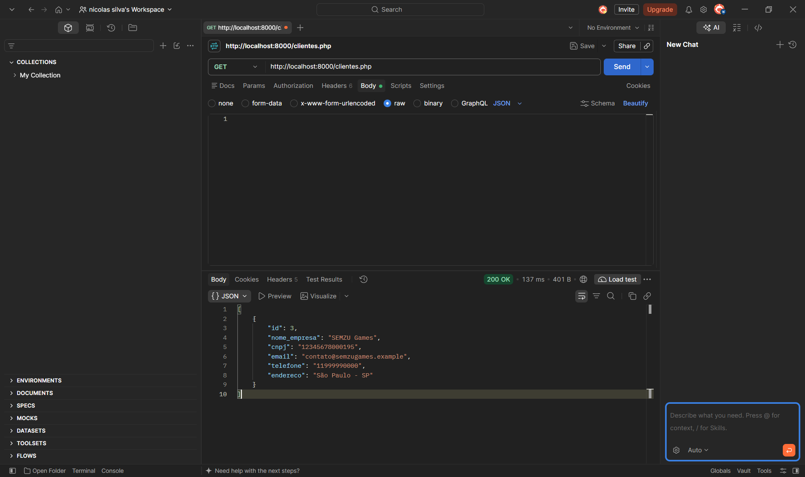

**POST — Cadastro de cliente**

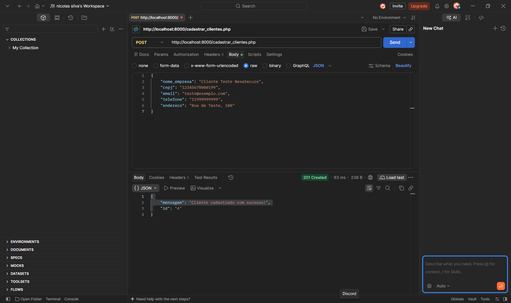

**PUT — Atualização de cliente**

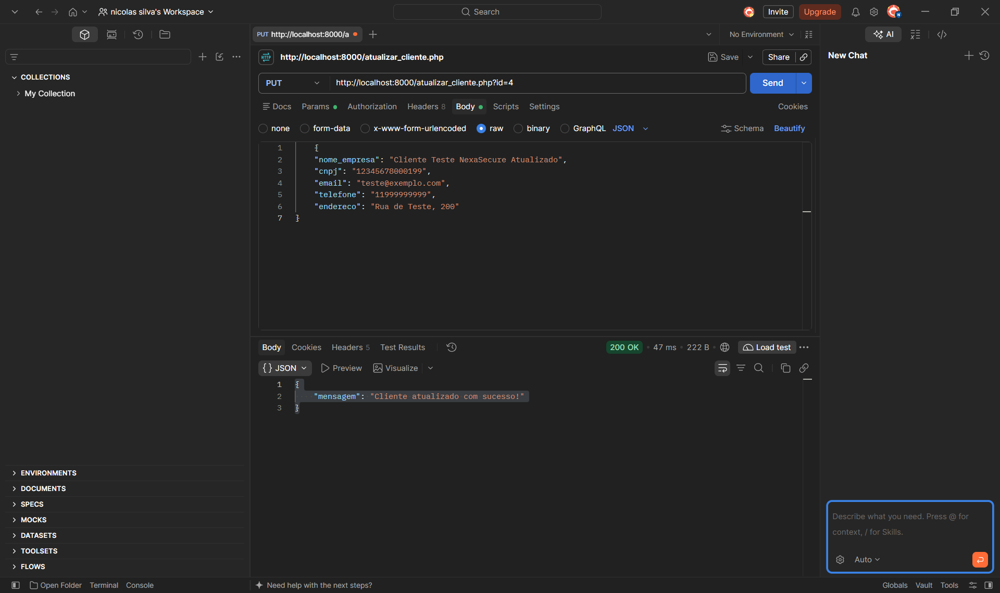

**DELETE — Exclusão de cliente**

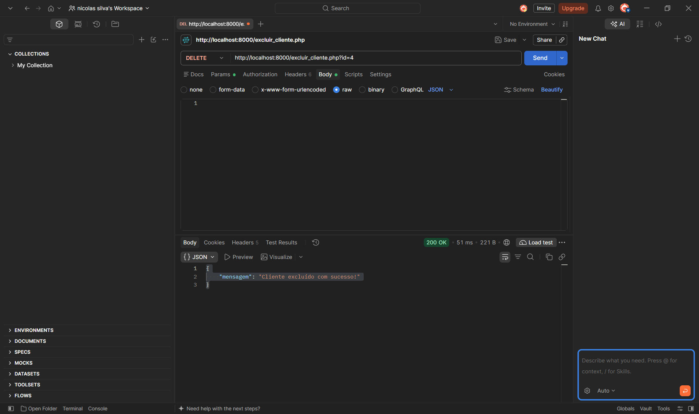

### 💻 Ativos

**GET — Consulta de ativos**

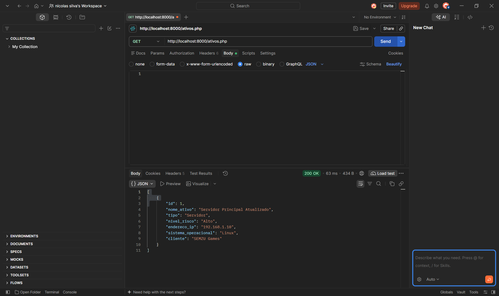

**POST — Cadastro de ativo**

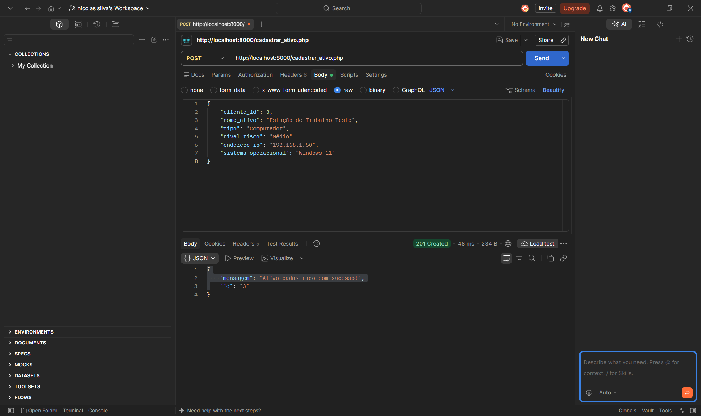

**PUT — Atualização de ativo**

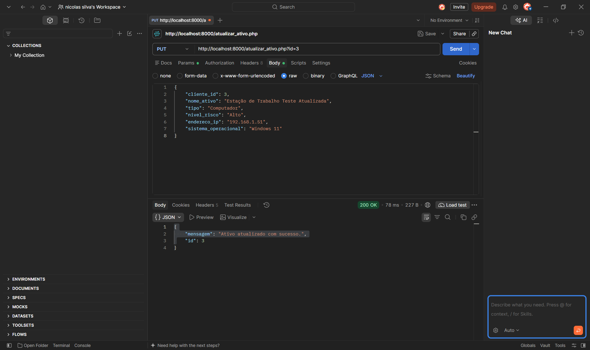

**DELETE — Exclusão de ativo**

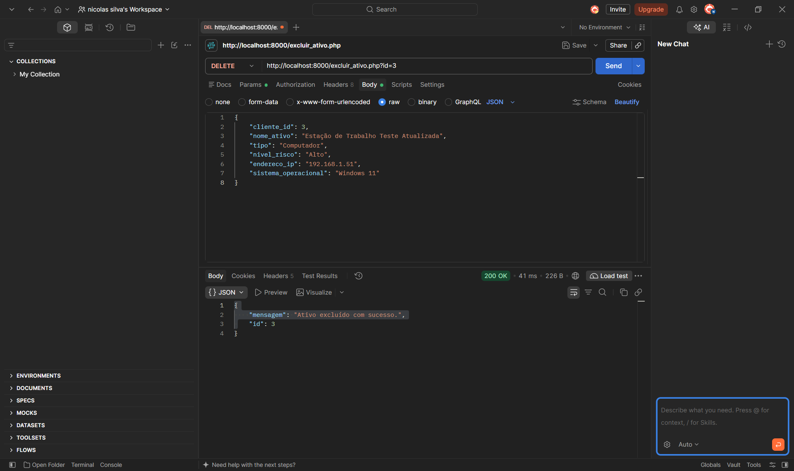

### 🛠️ Ordens de serviço

**GET — Consulta de ordens**

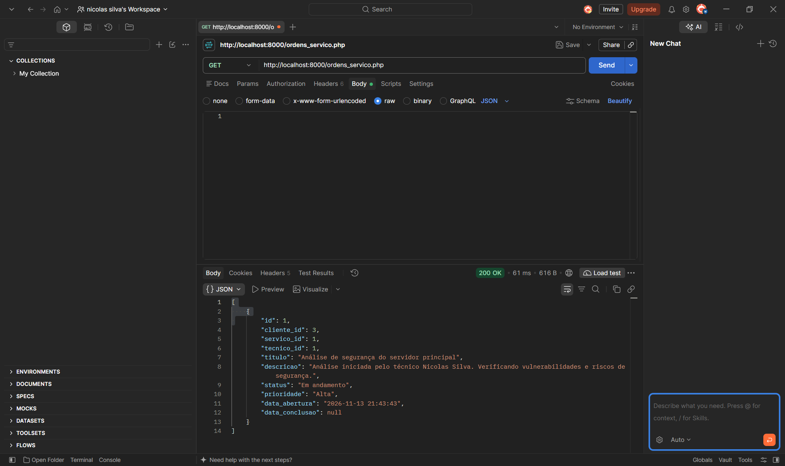

**POST — Cadastro de ordem**

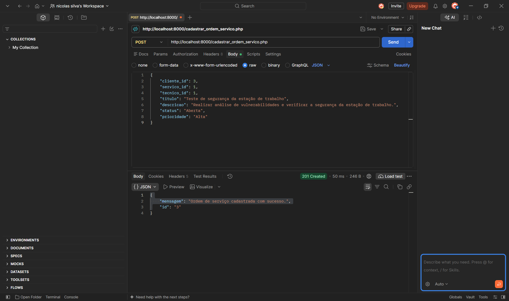

**PUT — Atualização de ordem**

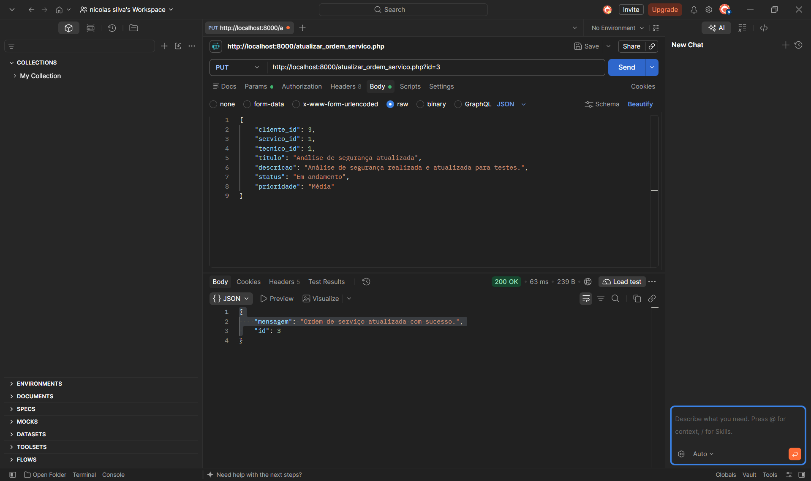

**DELETE — Exclusão de ordem**

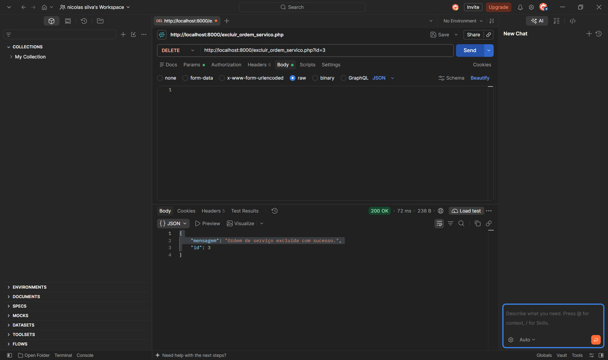